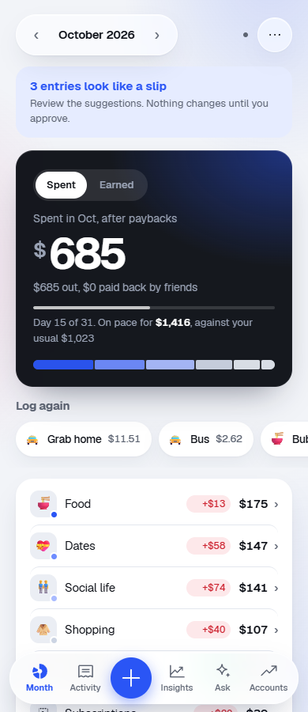

# 20bucks

A personal finance tracker that installs to your phone like a native app. Track everyday spending, split bills with friends, follow PayLater instalments, and see trading and poker P&L in one place. Data syncs to your own Supabase project and stays available offline.


<p align="center">
  
  
  
  
</p>
<p align="center"><sub>Month overview, activity feed, insights, and light mode. Shown with demo data.</sub></p>

## Features

- **Spending and budgets.** Categorised transactions, a monthly view that compares each category with what you usually spend by this day, and drill-down by category.
- **People and splits.** Tag who an expense was for and keep running "who owes me" balances.
- **PayLater and subscriptions.** Instalment schedules that handle month-end dates correctly.
- **Trading and poker P&L.** Prop firm, broker and poker results alongside regular spending.
- **Multi-currency wallets.** US dollar and crypto wallets valued live, plus a converter.
- **Imports.** Grab, bank statement CSVs and Money Manager `.xlsx` exports, with date validation and duplicate-safe re-imports.
- **Balance checks.** Count a wallet and see exactly what is missing since the last count.
- **Insights.** Monthly patterns, savings per month and data-health checks.
- **AI assistant (optional).** A weekly review that flags likely mistakes for you to approve, and a chat that answers questions about your money, with tables and maths rendered inline.
- **Private by default.** Email one-time-code sign-in, optional PIN or Face ID/fingerprint lock per device, and row level security so each account only sees its own data.
- **Works offline.** A service worker caches the app, and changes sync when you are back online.

## Tech stack

| Layer | Technology |
| --- | --- |
| Front end | Single-page app in vanilla HTML, CSS and JavaScript; installable PWA with a service worker |
| Back end | Supabase (Postgres, Auth, row level security) |
| AI | Supabase Edge Function (`supabase/functions/ledger-ai`) calling Mistral or Anthropic Claude |
| Hosting | Netlify (security headers and CSP in `netlify.toml`) or GitHub Pages |
| Email | Resend SMTP for sign-in codes |

## Project structure

```
index.html                 page shell
app.css                    styles
js/app.js                  the app
js/dates.js                date helpers (month-end rules, statement date parsing)
js/mm-import.js            Money Manager import mapper
tests/                     unit tests (npm test)
sw.js                      offline cache
config.js                  Supabase URL and public anon key
manifest.webmanifest       install metadata
supabase/schema.sql        tables and row level security policies
supabase/functions/        AI assistant Edge Function
netlify.toml               build, cache and security headers
vendor/                    third-party libraries, served locally: sign-in, charts, spreadsheet and PDF import, maths
icons/                     app icons
docs/screenshots/          demo screenshots
```

## Running tests

```bash
npm test
```

Needs Node 18 or newer and nothing else: no install step, no build. The tests cover the date rules that are easy to get wrong, such as instalments and renewals on the 29th to 31st, leap years, and impossible statement dates like 31 Feb.

## Getting started

### 1. Supabase

1. Create a project at [supabase.com](https://supabase.com). The free tier is enough.
2. **SQL Editor → New query**, paste `supabase/schema.sql`, and run it. It is safe to run again.
3. **Email (SMTP).** The built-in sender is rate limited and often lands in spam, so use [Resend](https://resend.com) instead. Create an API key, then in **Project Settings → Auth → SMTP Settings** enable Custom SMTP:
   - Host `smtp.resend.com`, Port `587`, Username `resend`, Password = your Resend API key
   - Sender email `onboarding@resend.dev` (works without a domain), Sender name `20bucks`
4. **Authentication → Sign In / Providers → Email:** make sure it is enabled, and turn off "Confirm email" if present (code sign-in does not need it).
5. **Authentication → Email Templates → Magic Link:** replace the body so it shows the code:

   ```html
   <h2>Your 20bucks code</h2>
   <p>Enter this code in the app to sign in:</p>
   <p style="font-size:32px;font-weight:bold;letter-spacing:8px">{{ .Token }}</p>
   <p>It expires within the hour. If you did not ask for it, ignore this email. Only the newest code works — requesting another one replaces the previous code.</p>
   ```

6. **Authentication → URL Configuration:** set Site URL to your deployed address and add it to Redirect URLs.
7. **Project Settings → API:** copy the Project URL and `anon` public key into `config.js`. The anon key is safe to publish; row level security protects the data.

### 2. Deploy

**Netlify (recommended):** connect the repository. `netlify.toml` publishes only the app files and applies the security headers. Update the Supabase URL in the Content-Security-Policy `connect-src` to match your project.

**GitHub Pages:** **Settings → Pages → Deploy from a branch → `main` / root.** The app will be at `https://<username>.github.io/<repo>/`.

A public repository only exposes the code. Your data lives in Supabase behind row level security, and `.gitignore` blocks backups and spreadsheets from being committed.

### 3. First run

1. Open the site on your phone, enter your email and tap "Email me a code", then enter the code from the email. A short welcome tour appears on your first sign-in, and ⋯ → Help reopens the full guide any time.
2. Optionally restore a backup (**⋯ → Restore a backup**) or import a Money Manager export.
3. Install it: Safari → Share → Add to Home Screen, or Chrome → ⋮ → Install app.
4. Once your account exists, turn off **Allow new users to sign up** in Supabase if the app is just for you.

## AI assistant (optional)

Off until enabled in **Settings → AI assistant**. Once a week it sends entries added since its last review (date, type, amount, category and note), plus the type of each category and your usual patterns for those notes and categories, worked out from your older entries, and puts anything it flags in Suggestions for you to approve. Questions you ask send your full history so the answer has context.

The API key never lives in this repository; it is stored as a Supabase secret:

```bash
npx supabase login
npx supabase functions deploy ledger-ai --project-ref <project-ref> --use-api
```

Then in **Supabase → Edge Functions → Secrets** add `MISTRAL_API_KEY`, or `ANTHROPIC_API_KEY` with `AI_PROVIDER=anthropic`. Optional overrides: `MISTRAL_MODEL`, `ANTHROPIC_MODEL`. Also add `AI_ALLOWED_IDS`: your user id from **Authentication → Users** (the UUID), comma-separated for a small team. The function answers nobody until it is set — sign-in lets anyone create an account, so without the allowlist a stranger could spend your API key. Set a monthly spending limit with your AI provider as a safety net.

## Custom domain (optional)

1. Buy a domain from Cloudflare, Porkbun or Namecheap. Avoid free TLDs such as `.tk`, which browsers and email providers distrust.
2. Use a subdomain per project, for example `20bucks.yourname.com`. Avoid brand names (`ledger`, `wallet`, `bank`, `paypal`) in the subdomain: Google Safe Browsing can flag a sign-in page that uses one as deceptive.
3. In Netlify, add the custom domain; HTTPS is issued automatically. In your DNS, add a CNAME pointing to `<your-site>.netlify.app`.
4. Update the Site URL and Redirect URLs in Supabase.
5. In Resend, verify the domain and change the sender to `code@yourname.com`.

## Troubleshooting

| Problem | Fix |
| --- | --- |
| No code box, or "sign-in is unavailable" | Something failed to load. Check your connection, then fully close and reopen the app twice. |
| Browser warns the site is dangerous | Common for code-by-email login pages on free hosting addresses. Use a custom domain, and if it persists request a review in Google Search Console. |
| 504 errors in the console | A temporary server error. Reload; the app keeps working from cache. |
| Second "Verify" says the code is wrong | The first press worked and used the code. Wait a few seconds or reopen the app. |
| Phone shows an old version | Close and reopen the app twice; the cache refreshes in the background. |
