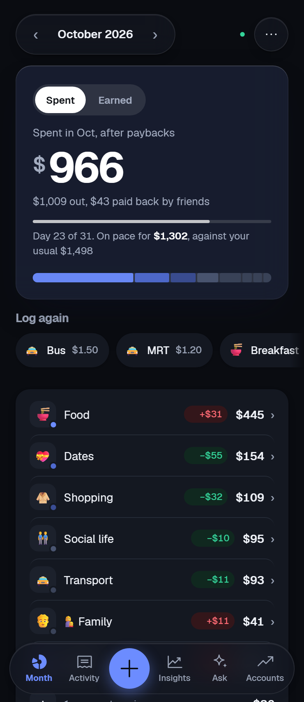
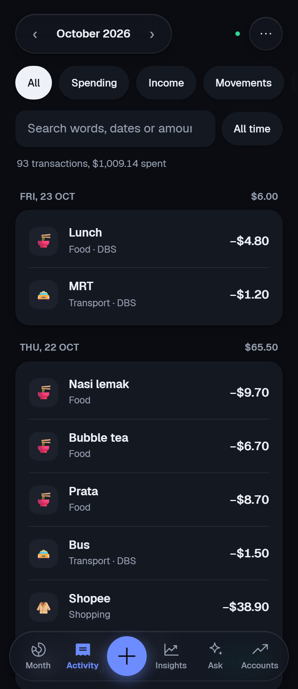
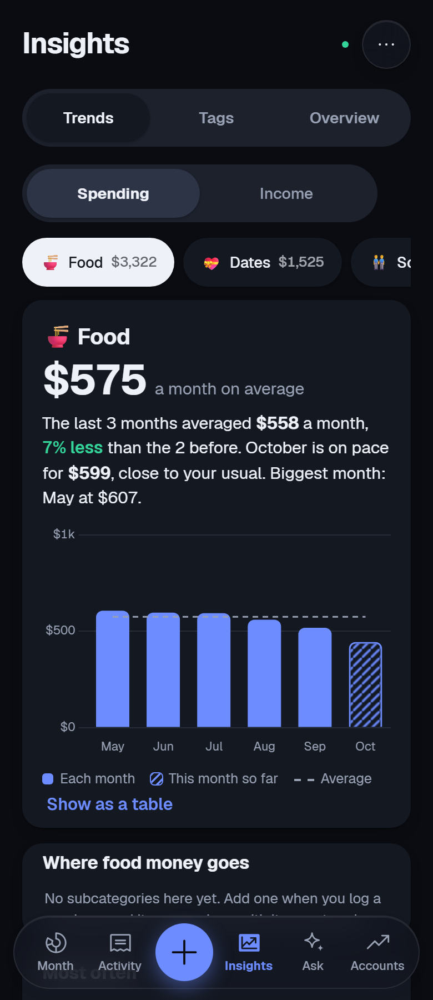
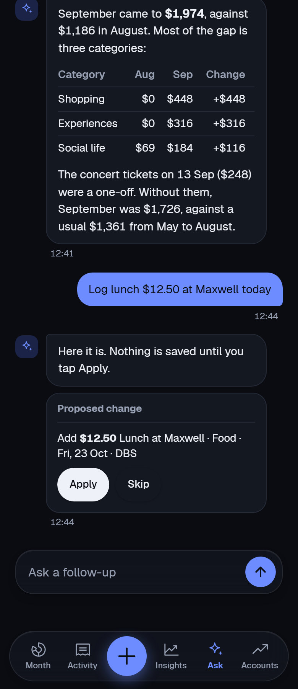

# 20bucks

A personal finance tracker that installs to your phone like a native app. Track everyday spending, split bills with friends, follow PayLater instalments, and see trading and poker P&L in one place. An optional AI assistant answers questions about your money and flags entries that look wrong. Data syncs to your own Supabase project and stays available offline.


<p align="center">
  
  
  
  
</p>
<p align="center"><sub>Month overview, activity feed, insights, and the Ask chat proposing a change. Shown with demo data.</sub></p>

## At a glance

| | |
| --- | --- |
| **Live** | https://20bucks.ethantam.dev |
| **Hosting** | Cloudflare Pages, connected to this repository; every push to `main` deploys. No build step: the build command copies the app files into `dist/` (see `MIGRATION.md`) |
| **Data** | Supabase (Postgres, Auth, row level security) plus the `ledger-ai` Edge Function |
| **Run locally** | Serve the repository root with any static server, for example `npx serve .`, then open the printed address. `npm test` runs the tests. |
| **Source** | [gitlab.com/eatentam/moneytracker](https://gitlab.com/eatentam/moneytracker) (moved from GitHub on 17 Oct 2026) |

Settings (names only; the values live in `config.js` and Supabase secrets):

- **App (`config.js`, public):** `supabaseUrl`, `supabaseAnonKey`, `googleClientId`
- **Edge Function secrets:** `MISTRAL_API_KEY` or `ANTHROPIC_API_KEY`, `AI_PROVIDER`, `AI_ALLOWED_IDS`; optional `MISTRAL_MODEL`, `ANTHROPIC_MODEL`

## Features

- **Spending and budgets.** Categorised transactions, and a monthly view that compares each category with what you usually spend by this day. Drill down by category for the detail.
- **People and splits.** Tag who an expense was for and keep running "who owes me" balances.
- **PayLater and subscriptions.** Instalment schedules that handle month-end dates correctly.
- **Trading and poker P&L.** Prop firm and broker results, plus poker, alongside regular spending.
- **Multi-currency wallets.** US dollar and crypto wallets valued live, plus a converter.
- **Imports.** Grab, bank statement CSVs and Money Manager `.xlsx` exports, with date validation and duplicate-safe re-imports.
- **Balance checks.** Count a wallet and see exactly what is missing since the last count. A gap stays open after later counts until something you log explains it, and an entry dated on the wrong side of a count is spotted from the opposite gaps it leaves either side.
- **Insights.** Monthly patterns and savings per month, plus data-health checks.
- **AI assistant (optional).** A weekly review that flags likely mistakes for you to approve, and a chat that answers questions about your money, with tables and maths rendered inline. Ask it to log, fix or delete an entry and it proposes the change as a card: nothing changes until you tap Apply (and Undo takes it back).
- **Private by default.** Email one-time-code or Google sign-in, and an optional PIN or Face ID/fingerprint lock per device. Row level security keeps each account to its own data.
- **Works offline.** A service worker caches the app, and changes sync when you are back online.

## Architecture

```
Phone / browser ── static files (Cloudflare Pages) ── service worker keeps it working offline
      │
      ├──▶ Supabase Auth       email code or Google sign-in
      ├──▶ Supabase Postgres   ledger_docs: one JSON document per month and per list, row level security
      └──▶ Edge Function       ledger-ai ──▶ Mistral (or Anthropic Claude)   only when the assistant is on
```

| Path | Purpose |
| --- | --- |
| `index.html`, `app.css` | Page shell and styles |
| `js/app.js` | The app |
| `js/dates.js` | Date helpers (month-end rules, statement date parsing) |
| `js/mm-import.js` | Money Manager import mapper |
| `js/google-signin.js` | Google sign-in button |
| `supabase/schema.sql` | Tables and row level security policies |
| `supabase/functions/ledger-ai/` | The AI assistant's Edge Function; it holds the API key |
| `sw.js` | Offline cache |
| `config.js` | Supabase URL and public anon key |
| `_headers`, `netlify.toml` | Security headers and CSP for Cloudflare Pages, and the older Netlify config |
| `vendor/` | Third-party libraries, served locally: sign-in, charts, spreadsheet and PDF import, maths |
| `tests/` | Unit tests (`npm test`) |
| `docs/screenshots/` | The screenshots above |

The browser only ever holds the public anon key. Every row is locked to its owner by row level security, and the AI provider's key lives in Supabase as a secret, never in this repository.

## Getting started

### 1. Supabase

1. Create a project at [supabase.com](https://supabase.com). The free tier is enough.
2. **SQL Editor → New query**, paste `supabase/schema.sql`, and run it. It is safe to run again.
3. **Email (SMTP).** The built-in sender is rate limited and often lands in spam, so use [Resend](https://resend.com) instead. Create an API key, then in **Project Settings → Auth → SMTP Settings** enable Custom SMTP:
   - Host `smtp.resend.com`, Port `587`, Username `resend`, Password = your Resend API key
   - Sender email `onboarding@resend.dev` (works without a domain), Sender name `20bucks`
4. **Authentication → Sign In / Providers → Email:** make sure it is enabled, and turn off "Confirm email" if present (code sign-in does not need it).
5. **Authentication → Email Templates → Magic Link:** replace the body so it shows the code:

   ```html
   <h2>Your 20bucks code</h2>
   <p>Enter this code in the app to sign in:</p>
   <p style="font-size:32px;font-weight:bold;letter-spacing:8px">{{ .Token }}</p>
   <p>It expires within the hour. If you did not ask for it, ignore this email. Only the newest code works — requesting another one replaces the previous code.</p>
   ```

6. **Authentication → URL Configuration:** set Site URL to your deployed address and add it to Redirect URLs.
7. **Project Settings → API:** copy the Project URL and `anon` public key into `config.js`. The anon key is safe to publish; row level security protects the data.

### 2. Deploy

**Cloudflare Pages (what the live site uses):** connect the repository, set the build output directory to `dist` and the build command from `MIGRATION.md`. `_headers` applies the security headers. Update the Supabase URL in the Content-Security-Policy `connect-src` to match your project.

**Other static hosts:** there is no build step, so any static host (Netlify, GitLab Pages and so on) can serve the repository root. `netlify.toml` has the same headers for Netlify.

A public repository only exposes the code. Your data lives in Supabase behind row level security, and `.gitignore` blocks backups and spreadsheets from being committed.

### 3. First run

1. Open the site on your phone. Enter your email and tap "Email me a code", then enter the code from the email. A short welcome tour appears on your first sign-in, and ⋯ → Help reopens the full guide any time.
2. Optionally restore a backup (**⋯ → Restore a backup**) or import a Money Manager export.
3. Install it: Safari → Share → Add to Home Screen, or Chrome → ⋮ → Install app.
4. Once your account exists, turn off **Allow new users to sign up** in Supabase if the app is just for you.

### Tests

```bash
npm test
```

Needs Node 18 or newer and nothing else: no install step, no build. The tests cover the date rules that are easy to get wrong, like instalments and renewals on the 29th to 31st. They also check leap years. Impossible statement dates like 31 Feb never make it in.

## AI assistant (optional)

Off until enabled in **Settings → AI assistant**. Once a week it sends entries added since its last review (date, type, amount, category and note), plus the type of each category and your usual patterns for those notes and categories, worked out from your older entries, and puts anything it flags in Suggestions for you to approve. Questions you ask in the **Ask** tab send your full history so the answer has context.

The API key never lives in this repository; it is stored as a Supabase secret:

```bash
npx supabase login
npx supabase functions deploy ledger-ai --project-ref <project-ref> --use-api
```

Then in **Supabase → Edge Functions → Secrets** add `MISTRAL_API_KEY`, or `ANTHROPIC_API_KEY` with `AI_PROVIDER=anthropic`. Optional overrides: `MISTRAL_MODEL`, `ANTHROPIC_MODEL`. Right now `OPEN_TO_ALL` at the top of the function is `true`, so every signed-in account can use the assistant (up to 120 calls an hour each). Sign-in lets anyone create an account, so to keep the API key to yourself set it to `false` and add `AI_ALLOWED_IDS`: your user id from **Authentication → Users** (the UUID), comma-separated for a small team. Set a monthly spending limit with your AI provider as a safety net.

## Custom domain (optional)

1. Buy a domain from Cloudflare, Porkbun or Namecheap. Avoid free TLDs such as `.tk`, which browsers and email providers distrust.
2. Use a subdomain per project, for example `20bucks.yourname.com`. Avoid brand names (`ledger`, `wallet`, `bank`, `paypal`) in the subdomain: Google Safe Browsing can flag a sign-in page that uses one as deceptive.
3. Add the custom domain to the Pages project (**Custom domains**); HTTPS is issued automatically.
4. Update the Site URL and Redirect URLs in Supabase.
5. In Resend, verify the domain and change the sender to `code@yourname.com`.

## Troubleshooting

| Problem | Fix |
| --- | --- |
| No code box, or "sign-in is unavailable" | Something failed to load. Check your connection, then fully close and reopen the app twice. |
| Browser warns the site is dangerous | Common for code-by-email login pages on free hosting addresses. Use a custom domain, and if it persists request a review in Google Search Console. |
| 504 errors in the console | A temporary server error. Reload; the app keeps working from cache. |
| Second "Verify" says the code is wrong | The first press worked and used the code. Wait a few seconds or reopen the app. |
| Phone shows an old version | Close and reopen the app twice; the cache refreshes in the background. |

## Legal

See the [privacy policy](PRIVACY.md) and [terms](TERMS.md). Released under the [MIT License](LICENSE).
